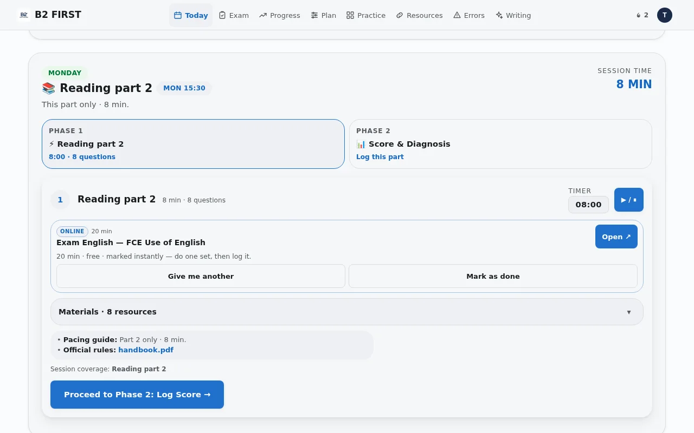
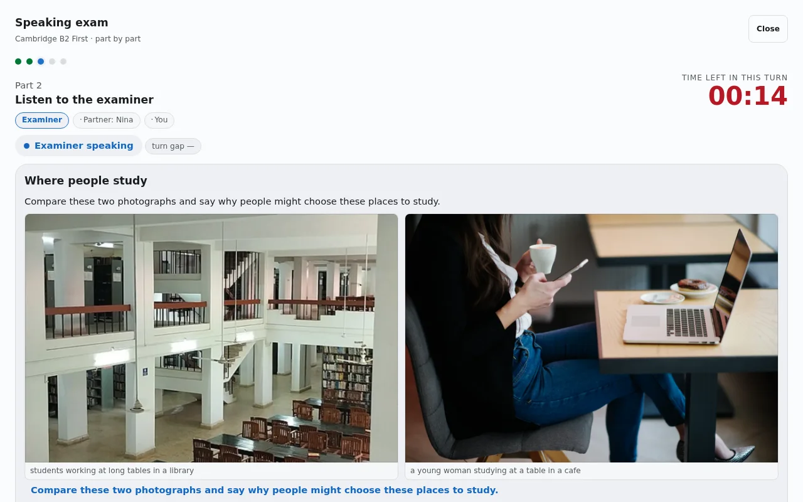
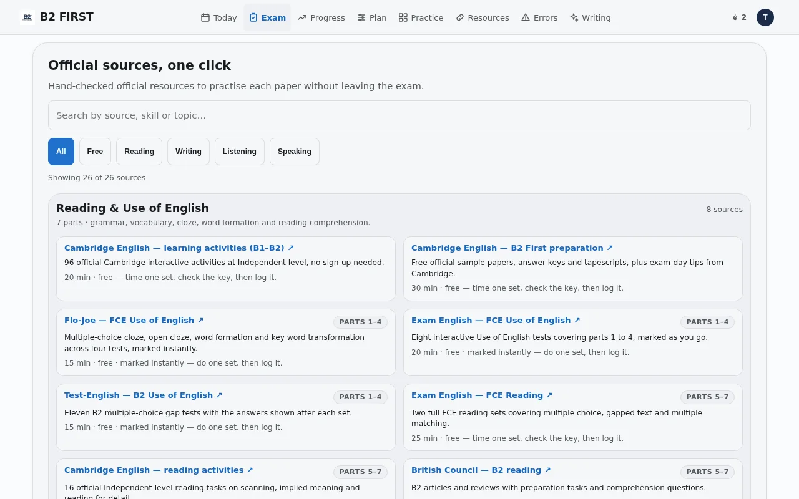

<p align="left">
  
</p>

# B2 First Tracker

Practice the Cambridge B2 First with an AI examiner, a writing corrector and a plan that knows what you did yesterday.

[](https://firsttracker.app)
[](server.py)
[](index.html)
[](tests/run_all.sh)
[](#how-the-ai-is-used)
[](LICENSE)

**Live service:** https://firsttracker.app

---

## Screenshots

<table>
  <tr>
    <td width="50%"></td>
    <td width="50%"></td>
  </tr>
  <tr>
    <td align="center"><sub><b>Today:</b> scheduled session, timer, and collapsible Materials</sub></td>
    <td align="center"><sub><b>Speaking Exam:</b> Parts 1–4 with official timings, photos, and examiner</sub></td>
  </tr>
  <tr>
    <td width="50%"></td>
    <td width="50%"></td>
  </tr>
  <tr>
    <td align="center"><sub><b>Writing Corrector:</b> 4-band Cambridge marking with live grading steps</sub></td>
    <td align="center"><sub><b>Exam Sources:</b> 26 curated resources grouped by paper with search & filters</sub></td>
  </tr>
</table>

---

## What it does

- **Daily exam plan derived from your log:** An optional 12-question diagnostic ranks your weakest exam parts. Two rotations (*By part* and *Full paper each session*) derive today's session directly from the units already logged, with official Cambridge timings, streak shields, and exam-day countdown.
- **Writing corrector on all four Cambridge bands:** Marks Essays, Articles, Reports, Reviews, and Emails from 0 to 5 on *Content*, *Communicative Achievement*, *Organisation*, and *Language*. Every band quotes evidence from your text, lists concrete weaknesses, rewrites three sentences, and displays a step-by-step progress bar with elapsed time while grading.
- **Cambridge AI Speaking examiner (Parts 1–4):** Runs a full 14-minute mock or a single part with official timings, a partner role from Part 2 onward that reacts to what you actually said, and custom task support (*Use my own task*).
- **Live Studio (local VAD):** Browser-only `AudioWorklet` voice activity detection (`assets/spk-vad.js`) measures speaking time and silences in real time; no audio is recorded or uploaded.
- **Practice (By part & unified Library):** Timed drills for every exam part alongside a single searchable, sortable **Library** tab combining local papers, answer keys, audio, lesson plans, examiner notes, reference handbooks, and verified online sources — plus private user-uploaded Listening practice files and inline session materials.
- **Progress by part and error type:** Four zero-dependency SVG charts track score trajectory, accuracy per exam part, error taxonomy (*vocabulary*, *grammar*, *distractor*, *time limit*), and skill consistency.

---

## How the AI is used

| Provider | Task | Model | Approx. cost | Fallback |
| --- | --- | --- | --- | --- |
| **Google (Gemini Live)** | Real-time Speaking examiner (Parts 1–4) | `gemini-3.8-live` (ephemeral token; direct browser ↔ Google WebSocket) | ~$0.0088 / min (~$0.123 per 14-min mock) | Turn-based Gemini 2.5 Flash, or browser speech synthesis/recognition |
| **Google (Gemini API)** | Turn-based Speaking voice (STT + reply + TTS) | `gemini-2.5-flash` + `gemini-2.5-flash-preview-tts` | ~$0.047 per 14-min mock | Browser Web Speech API (`SpeechRecognition` + `speechSynthesis`) |
| **DeepSeek** *(default; or Gemini)* | Writing 4-band grading, Speaking partner reactions, Speaking report | `deepseek-chat` (DeepSeek V4.1 Flash; strict JSON capped at 8 KB) | ~$0.0011–$0.0022 / writing; ~$0.0008 / report; ~$0.0003 / partner line | Bring-your-own key (BYO); scripted partner lines from task bank |
| **Microsoft Azure AI Speech** *(optional)* | Speaking Pronunciation band (0–5) | Azure Pronunciation Assessment (`POST /api/speaking/pa`) | Optional (operator-configured) | Returns `503 speech_not_configured`; report displays `not measured` |

- **Server-side keys only:** Shared API keys live in the server environment (`chmod 600` env file) and never reach the browser or the repository.
- **Bring your own key (BYO):** Users can configure their own provider key in **Settings → AI provider**. It stays in browser `localStorage`, is forwarded only on that user's requests, is never stored on the server, and bypasses shared service quotas.
- **No speaking audio stored:** Live Studio runs VAD locally in the browser and records nothing. Live Speaking streams directly from the browser to Google via a single-use ephemeral token minted by `POST /api/speaking/token`. Turn-based audio and optional Azure pronunciation clips are held in memory only for the single request and discarded immediately.

---

## The Speaking exam

The Speaking exam runs in the browser, one part at a time or as the full fourteen minutes of
Parts 1–4, with the timings of the real test:

| Part | Time | What happens |
| --- | --- | --- |
| **Part 1** | 2 min | The examiner asks personal questions and you answer; no partner. |
| **Part 2** | 4 min | You compare two photographs for a minute, answer a question about them, then your partner answers for thirty seconds. |
| **Part 3** | 4 min | You and your partner discuss a task card and reach a decision together. |
| **Part 4** | 4 min | The examiner asks discussion questions that follow the Part 3 topic. |

Two roles run the room. The **examiner** asks the task questions in order and keeps the clock; it
never teaches, corrects, praises or grades. The **partner** is a second candidate, from Part 2 on:
it takes its turn, answers about your photographs, asks one question back and returns the ball.
Its lines come from the task bank; with a text model configured it can also react to what you
actually said.

**How a session is built.** The task bank, `material/speaking.json`, holds original tasks written
for this app in the B2 First format — not past papers. Each part has its own task list, and
selection is seeded and rotates, so a task is not presented again until that part's pool has been
used. The chosen task and a countdown stay on screen while the exam runs; every turn has its own
clock, and after five seconds of silence the examiner asks one short question from the task
instead of waiting. You can also paste your own task for any part under **Use my own task**.
The Part 2 photographs are from Wikimedia Commons, with their credits recorded in
`assets/speaking/CREDITS.json`.

**Optional AI.** With no provider key the exam still runs: the browser's own speech synthesis
reads the examiner and partner lines, and the browser's speech recogniser (`en-GB`) writes your
turns into the transcript. Keys add three things, independently:

- **Live voice** — a short-lived token lets the browser talk to the provider directly, so the
  audio never passes through our server.
- **Turn-based voice** — one recorded turn is sent, and the examiner's reply comes back as text
  and audio. The audio is forwarded to the provider and dropped: it is never written to disk and
  never logged.
- **A partner that listens** — the last recognised line becomes one sentence grounded in what you
  said. Without a key, the written partner lines are used.

The text model and the voice model are configured by the operator of the service; you can also
connect your own provider key from the app.

**The report.** The report grades only the candidate's turns after a part. Grammar & Vocabulary
and Discourse Management come from the text model. Pronunciation comes only from Azure
Pronunciation Assessment, mapped to the Cambridge 0–5 scale; when Azure did not score the session
the band says *not measured* instead of guessing. Interactive Communication is graded only when
the session had a partner. Word and filler counts (`um`, `uh`, `like`, `you know`) are counted on
the recognised text, with no score attached. The report needs a text model; the exam itself does
not.

**What is sent, and what is not.** The exam content never leaves our server: the task bank is a
static file and the voices come from the browser. When a text or voice key is configured, the
browser sends the recognised candidate line to `POST /api/speaking/partner` for a reaction, one
turn's audio to `POST /api/speaking/turn` in turn-based voice, and the transcript with its timings
to `POST /api/speaking/report` when you ask for the report. No audio is ever written
by the server. Nothing is added to your log until you press **Save report**; the exam does not
store the transcript, and saving writes only the report row into your progress.

---

## What it does not do

This is a practice tool, not an exam board. The Writing and Speaking bands are estimates against
the published Cambridge scales: useful for finding the next thing to fix, but not an official
result, not a certificate and not a claim about the grade you will be given. The app is not
affiliated with or endorsed by Cambridge, and the tasks under `material/speaking.json` are original
ones written in the exam format, not past papers.

- **No pronunciation feedback without Azure.** Pronunciation is graded only by Azure Pronunciation
  Assessment (`POST /api/speaking/pa`). With no Azure key the endpoint answers
  `503 speech_not_configured`; the report card says *not measured* and lists no mispronounced
  words. The text model is told never to grade pronunciation, and any band it writes is discarded.
- **The live transcript depends on the browser.** It is written by the browser's Web Speech API
  (`SpeechRecognition` / `webkitSpeechRecognition`, `en-GB`); the app has no recogniser of its own.
  A browser without that API runs the whole exam with no transcript, and if you deny the
  microphone the note under the transcript says so while the examiner keeps the written script.
  The server receives audio only for the optional turn-based voice and the Azure clip, and stores
  neither.
- **You need an account.** Every session belongs to an account (username + 12-character password,
  Google sign-in, or passkey). There is no anonymous mode and no local-only mode.

---

## Architecture

Zero third-party Python dependencies (`http.server.ThreadingHTTPServer`), zero frontend build step, zero external database.

```text
browser (index.html + AudioWorklet VAD)
  │
  ├── HTTPS ──► server.py (Python 3.11+ stdlib)
  │               ├── static HTML/assets (landing.html, index.html, material/)
  │               ├── auth & security (PBKDF2-600k, OAuth, WebAuthn, TOTP MFA, CSP)
  │               ├── store.py ──► per-account atomic JSON + 20-version backups
  │               ├── plans.py ──► per-account UTC daily usage meter
  │               └── AI proxies ──► DeepSeek / Gemini (writing, partner, report, turn)
  │                              ──► Azure AI Speech (optional pronunciation)
  │                              ──► Gemini Live ephemeral token mint
  │
  └── WSS (ephemeral token, direct) ──► Google Gemini Live API (audio never hits server)
```

### Main files

| File | Role |
| --- | --- |
| [`server.py`](server.py) | Standard-library `ThreadingHTTPServer`: routing, auth, CSP/security headers, rate limits, AI & speaking proxies. |
| [`store.py`](store.py) | Storage seam for atomic JSON reads/writes, per-account progress, backups, and speaking ledgers. |
| [`plans.py`](plans.py) | Service-level daily caps (`service`, `byo`, `owner`) and UTC day/week/month usage meter (`data/usage.json`). |
| [`prompts.py`](prompts.py) | Official Cambridge B2 First Writing rubric and strict-JSON grading prompts. |
| [`speaking_prompts.py`](speaking_prompts.py) | Scripted Cambridge examiner and grounded partner prompts for Parts 1–4. |
| [`speaking_report.py`](speaking_report.py) | Four-scale Speaking report parser and validator (strips any guessed pronunciation band). |
| [`speech.py`](speech.py) | Pure-stdlib Azure Pronunciation Assessment helpers (audio container validation and score mapping). |
| [`oauth_google.py`](oauth_google.py) | Stdlib Google OAuth 2.0 + PKCE and RS256 JWKS `id_token` verification. |
| [`webauthn.py`](webauthn.py) | Stdlib CBOR/COSE WebAuthn passkey registration and assertion verification. |
| [`mfa.py`](mfa.py) | RFC 6238 TOTP two-factor authentication and hashed one-time recovery codes. |
| [`legal.py`](legal.py) | Sanitized stdlib Markdown renderer serving `/privacy`, `/terms`, and `/security` from `docs/`. |
| [`wordlist.py`](wordlist.py) | Embedded 1,000-entry sourced password blocklist plus deterministic derivatives (22,492 candidates). |
| [`index.html`](index.html) | Complete single-file tracker UI (EN/ES i18n, light/dark oklch themes, SVG charts, exam timers, Speaking UI). |
| [`landing.html`](landing.html) | Public landing page served at `/`. |
| [`assets/spk-vad.js`](assets/spk-vad.js) | Local `AudioWorkletProcessor` voice activity detector for Live Studio. |
| [`assets/spk-tx.js`](assets/spk-tx.js) | Local `AudioWorkletProcessor` 16 kHz PCM capture for Speaking turns and Live. |
| [`material/`](material/speaking.json) | Static exam banks (`speaking.json`, `diagnostico.json`, `writing-samples.json`). |

---

## Quick start

### Try the hosted app

1. Open https://firsttracker.app and click **Start free** (or **Create an account**).
2. Choose a username and a password of at least 12 characters (no email required), or sign in with Google.
3. Set your exam date in onboarding (you can click **Skip for now** on the 12-question diagnostic and run it later).
4. Submit a 140–190 word essay in **Writing**, or open **Speaking Exam** from **Today**.

### Run locally from source

Requires Python 3.11+ (stdlib only — no `pip install`, no Node.js):

```bash
git clone https://github.com/Juan-Martin-Cerezo/b2first-tracker.git
cd b2first-tracker
python3 server.py
```

The server listens on `http://127.0.0.1:8088` (`/` is the landing page, `/app` is the tracker) and stores accounts and progress under `./data/`.

- **Creating your local account:** Open `http://127.0.0.1:8088/app`, click **Create an account**, and pick a username and 12+ character password. There is no anonymous or demo mode in `server.py`.
- **Enabling AI locally:** Export a text provider key and/or Google Gemini key before starting `server.py` (see [`docs/CONFIGURATION.md`](docs/CONFIGURATION.md)), or paste your own key directly inside **Settings → AI provider** in the browser.
- **Docker:** `docker build -t b2first . && docker run -p 8088:8088 -v b2data:/app/data b2first`

---

## Configuration

All runtime settings are passed as environment variables (never committed to the repo). See [`docs/CONFIGURATION.md`](docs/CONFIGURATION.md) for the exact environment variable names and complete reference.

| Setting | Default | Effect |
| --- | --- | --- |
| Text AI provider | `deepseek` | Selects `deepseek` or `gemini` for Writing grading, Speaking partner lines, and Speaking reports. |
| Text AI model | `deepseek-chat` (`gemini-2.0-flash` for Gemini) | Model ID forwarded to the text provider. |
| Text AI API key | *(unset)* | Shared server-side key for text grading. When unset, server grading returns `503 ai_not_configured` unless a BYO key is supplied. |
| Speaking Google key | *(unset)* | Enables Gemini ephemeral Live tokens and turn-based Gemini 2.5 Flash voice/TTS. |
| Speaking Live toggle | *(off)* | Enables direct browser ↔ Gemini Live WebSocket sessions (`gemini-3.8-live`); off falls back to turn-based voice or browser speech. |
| Instance daily AI / voice caps | `1200` text calls / `600` voice min | Instance-wide ceilings across non-owner accounts (hosted production sets tighter caps to match prepaid balance). |
| Global monthly Live guard | `900` min / month | Hard monthly ceiling tracked in `data/spk_spend.json`; enforced on **every** account including owners. |
| Owner account IDs | `owner` | Comma-separated user IDs exempt from daily writing/speaking caps (monthly guard and per-minute rate limits still apply). |
| Bind address & port | `127.0.0.1` · `8088` | Loopback by default for reverse-proxy deployments; override via `PORT` and bind host setting. |
| Data directory | `./data` | Location for accounts, hashed tokens, progress, backups, usage meter, and audit log (`DATA_DIR`). |
| Registration policy | `open` | Set to `closed` to disable new public signups. |

---

## Limits & cost

### Daily & monthly limits

| Tier | Writing evaluations | Speaking mocks / minutes | Global monthly Live guard |
| --- | --- | --- | --- |
| **Standard account (`service`)** | **5 / UTC day** (`plans.py`) | **1 mock · 15 min / UTC day** (`plans.py`) | Enforced (`900` min/month default) |
| **Bring-your-own key (`byo`)** | Unmetered by server | Unmetered by server | Billed to user's own key |
| **Owner account (`owner`)** | Uncapped per day (`plans.py`) | Uncapped per day (`plans.py`) | **Enforced** (applies to everyone) |
| **Hosted instance ceiling** | Configurable (20 text calls/day on hosted instance) | Configurable (25 voice min/day on hosted instance) | Enforced across all accounts |

### Estimated provider cost per session

Measured against published DeepSeek and Google Gemini API pricing (documented in `plans.py`):

| Action | Provider / model | Estimated cost |
| --- | --- | --- |
| Writing evaluation (140–190 words + rubric prompt) | DeepSeek (`deepseek-chat`) | ~$0.0011 (off-peak) – $0.0022 (peak) |
| Speaking final report (JSON) | DeepSeek (`deepseek-chat`) | ~$0.0008 |
| Speaking partner reaction (1 line) | DeepSeek (`deepseek-chat`) | ~$0.0003 |
| Speaking Live voice (1 minute) | Google (`gemini-3.8-live`) | ~$0.0088 / min |
| Full 14-minute Speaking mock (Live) | Google (`gemini-3.8-live`) | ~$0.123 |
| Full 14-minute Speaking mock (turn-based fallback) | Google (`gemini-2.5-flash` + TTS) | ~$0.047 |

---

## Testing

The repository ships **149 standalone test suites** under `tests/test_*.py` (no pytest required). Every suite boots an isolated server with a throwaway `DATA_DIR`, a free port, and offline provider stubs, so real user data is never touched and no network calls are made.

```bash
cd tests
uv run --no-project --with playwright --with httpx python test_final.py
uv run --no-project --with playwright --with httpx python test_readme_limits.py
uv run --no-project --with playwright --with httpx python test_landing_honest.py

# Run every suite with one exit code (logs saved to tests/out/run_all/)
./run_all.sh
./run_all.sh speaking    # run only suites matching a substring
```

| Group | Representative suites | What they verify |
| --- | --- | --- |
| **UI, layout & i18n** | `test_final.py`, `test_layout.py`, `test_mobile.py`, `test_i18n.py`, `test_landing_honest.py` | Every view renders with zero JS/CSP errors, light/dark contrast >= 4.5:1, EN/ES parity, 360/390/768/1440 px layout. |
| **Plan, diagnostic & progress** | `test_plan.py`, `test_diag.py`, `test_streak.py`, `test_progression.py`, `test_graf.py`, `test_today_compact.py` | Deterministic rotation, 12-item diagnostic, streak shields, stage gates, four SVG charts. |
| **Writing AI & guards** | `test_ai.py`, `test_ai_guard.py`, `test_writing_progress.py` | Strict JSON schema validation, injection/leak guards, live progress bar and elapsed timer, rate limits. |
| **Speaking exam & voice** | `test_speaking_exam.py`, `test_speaking_live.py`, `test_speaking_custom_task.py`, `test_partner_grounding.py`, `test_speaking_pa.py`, `test_speaking_turn_budget.py` | All 4 parts, custom tasks, grounded partner replies, Live tokens, turn-based TTS, Azure PA `not measured` contract, monthly budget. |
| **Materials & sources** | `test_where_to_find.py`, `test_exam_sources_blocks.py`, `test_listening_own_material.py` | Block layout with paired keys, 26 searchable Exam sources, private Listening uploads. |
| **Auth & accounts** | `test_register.py`, `test_multiuser.py`, `test_auth_methods.py`, `test_mfa.py`, `test_owner_unlimited.py` | Account isolation, Google OAuth, WebAuthn passkeys, TOTP MFA, owner limits, export & deletion. |
| **Security, legal & load** | `test_security2.py`, `test_security3.py`, `test_server_hardening.py`, `test_legal.py`, `test_readme_limits.py`, `test_capacity.py` | Lockout/backoff, hash-chained audit log, CSP, raw HTTP limits, `/privacy` `/terms` `/security`, measured p95 throughput. |

---

## Privacy & security

Progress lives in private per-account JSON files on the server (PBKDF2-HMAC-SHA256 @ 600,000 iterations, SHA-256 hashed tokens, hash-chained audit log, zero speaking audio written to disk, and only cookie-free aggregate Cloudflare Web Analytics — no ads or profiling).

- [Privacy Policy](docs/PRIVACY.md) (`/privacy`)
- [Terms of Use](docs/TERMS.md) (`/terms`)
- [Security Policy](docs/SECURITY.md) (`/security`) & [Security Model](SECURITY.md)
- [Data Map](docs/DATA-MAP.md) & [ASVS 4.0.3 Checklist](docs/SECURITY-CHECKLIST.md)
- [Documentation Index](docs/README.md)

---

## Roadmap

- **Rubric calibration against real marked scripts:** Benchmark Writing and Speaking band estimates against published Cambridge examiner commentaries (`tools/calibrate.py`).
- **Full ASVS top-3,000 password blocklist:** Expand `wordlist.py` from the current 1,000 sourced entries (plus derivatives) to the full top-3,000 list.
- **Teacher / classroom view:** Optional read-only progress summary for academies or tutors reviewing a student's writing and error log.
- **Offline practice packs:** Service-worker caching for static practice papers and answer keys when studying without a connection.

---

## License

[MIT](LICENSE) © 2026 Juan Martín Cerezo
