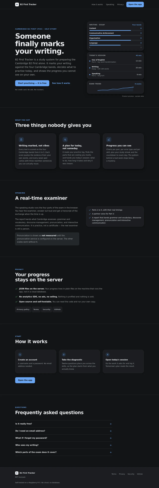
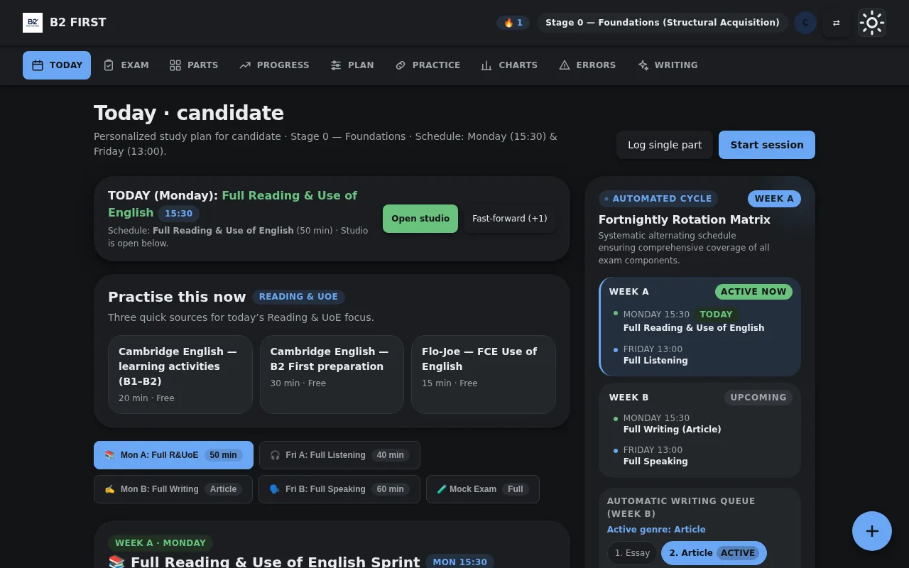
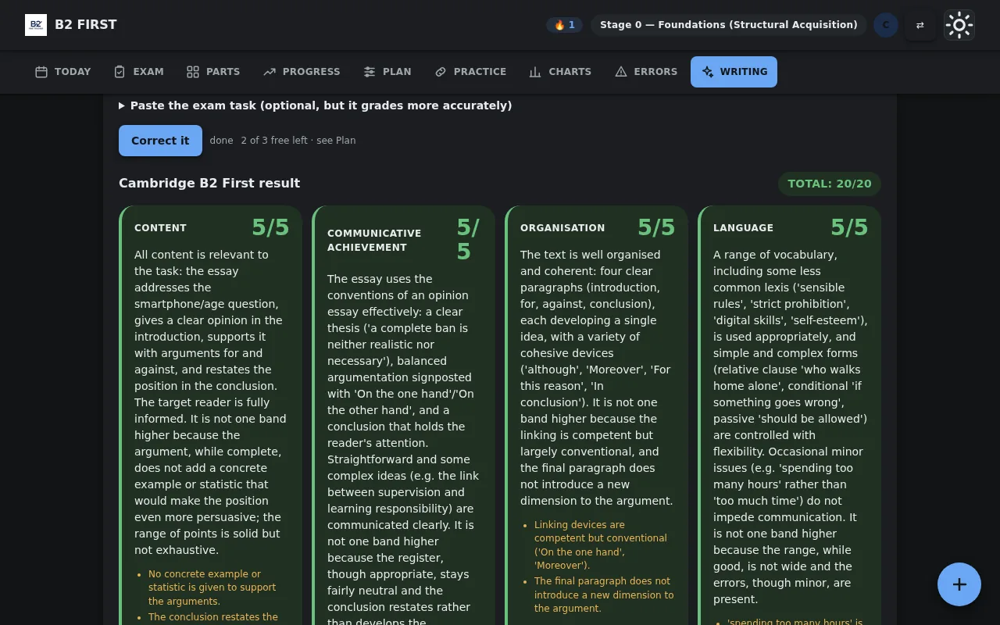
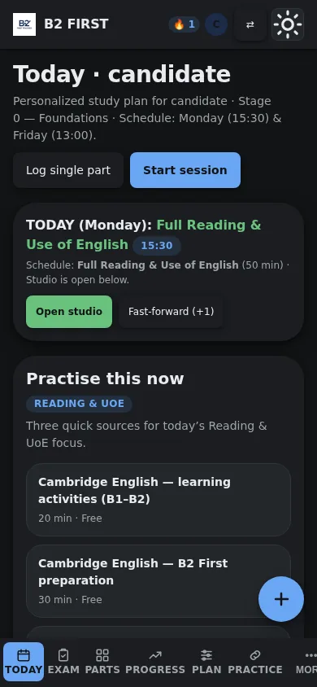

<p align="left">
  
</p>

# B2 First Tracker

A self-hosted study system for the Cambridge B2 First: writing marked against the four Cambridge
bands, a plan for today, and progress you can see.

**Live demo:** https://firsttracker.app




## Why it exists

**Nobody tells you whether your Writing is good.** Writing is a quarter of the mark, and it is the
one paper whose answer key cannot exist: two answers can both be correct English while one is a
Band 4 and the other a Band 2. Reading and Listening practice tests come with answers, so they tell
you. Writing does not, and neither does a friend who has never seen a Cambridge scale. The app marks
every text on the four official bands, quotes the sentence that earned or cost each mark, and
rewrites three of your own sentences.

**Nobody tells you what to study today.** By week three the real question is not *what exists* but
*which of the ten things in front of me should I open tonight?* Answering it costs ten minutes of
second-guessing, and on a Tuesday night with forty minutes free that is enough to skip the session.
The app reads the diagnostic, your practice log and your exam date, and hands you today's session:
what to do, how long it takes, and why it was chosen.

**Progress is invisible, so consistency collapses.** A candidate who does five sessions in sixty-seven
days remembers the effort, not the frequency. Without a record there is no way to notice that the
last Listening test was three weeks ago or that Part 4 accuracy has not moved since March. The app
charts every log entry per part, per error type and per skill, and keeps the streak and the exam-day
countdown in view.

## Screenshots

<table>
  <tr>
    <td width="50%"></td>
    <td width="50%"></td>
  </tr>
  <tr>
    <td align="center"><sub>Today: the session chosen for you, with its reason</sub></td>
    <td align="center"><sub>Writing: four bands, quoted evidence and a total out of 20</sub></td>
  </tr>
</table>

<p align="center">
  
</p>


## Features

| Area | What it does |
| --- | --- |
| **Use of English & Reading** | Parts 1–7, with real exam-mode timings. Every session logs the part, score and minutes. |
| **Writing** | Four Cambridge bands, 0–5 each (Content, Communicative Achievement, Organisation, Language). Each band quotes evidence from your text, lists two concrete weaknesses, and adds three rewritten sentences. You can paste the exam task so the content is judged against it. |
| **Listening** | Full tests scored out of 30, or one part at a time. Part 2 errors are tracked against the stage gate. |
| **Speaking** | Parts 1–4 with their real timings: a real-time examiner, a partner voice for Part 3, and a report that bands grammar and vocabulary, discourse management, pronunciation and interactive communication. |
| **Plan** | The diagnostic ranks your weakest parts, the weekly plan turns that into sessions, the gates track the next stage, and the streak and countdown keep the week honest. |
| **Charts** | Four SVG panels, no chart library: progress over time, accuracy per part, the mix of error types, and score consistency per skill. |
| **Accounts** | Username and password, Google sign-in, and passkeys. Each account stores its own progress under `data/users/<id>/`. Recovery works through Google, a passkey, or a manual operator reset. |
| **Privacy** | Progress is JSON on your server. No analytics SDK, no ads, no external database. |

## The Speaking exam

The Speaking exam runs in the browser, one part at a time or as the full fourteen minutes of
Parts 1–4, with the timings of the real test:

| Part | Time | What happens |
| --- | --- | --- |
| **Part 1** | 2 min | The examiner asks personal questions and you answer; no partner. |
| **Part 2** | 4 min | You compare two photographs for a minute, answer a question about them, then your partner answers for thirty seconds. |
| **Part 3** | 4 min | You and your partner discuss a task card and reach a decision together. |
| **Part 4** | 4 min | The examiner asks discussion questions that follow the Part 3 topic. |

Two roles run the room. The **examiner** asks the task questions in order and keeps the clock; it
never teaches, corrects, praises or grades. The **partner** is a second candidate, from Part 2 on:
it takes its turn, answers about your photographs, asks one question back and returns the ball.
Its lines come from the task bank; with a text model configured it can also react to what you
actually said.

**How a session is built.** `material/speaking.json` is the task bank: original tasks written for
this app in the B2 First format — not past papers. Each part has its own task list, and selection
is seeded and rotates, so a task is not presented again until that part's pool has been used. The
chosen task and a countdown stay on screen while the exam runs; every turn has its own clock, and
after five seconds of silence the examiner asks one short question from the task instead of
waiting. The Part 2 photographs are from Wikimedia Commons, with their credits recorded in
`assets/speaking/CREDITS.json`.

**Optional AI.** With no provider key the exam still runs: the browser's own speech synthesis
reads the examiner and partner lines, and the browser's speech recogniser (en-GB) writes your
turns into the transcript. Keys add three things, independently:

- **Live voice** — `POST /api/speaking/token` mints a single-use token and the browser talks to
  the provider directly, so the audio never passes through this server.
- **Turn-based voice** — `POST /api/speaking/turn` takes one recorded turn and returns the
  examiner's reply as text and audio. The audio is forwarded to the provider and dropped: it is
  never written to `data/` and never logged.
- **A partner that listens** — `POST /api/speaking/partner` turns the last recognised line into
  one sentence. Without a key (the server's or your own), the written partner lines are used.

The text model is `B2_AI_KEY` or your own provider key from the app; the voices use
`B2_SPK_GOOGLE_KEY`. The full list, with defaults, is in the Speaking table under
[Configuration](#configuration).

**The report.** `POST /api/speaking/report` grades only the candidate's turns after a part.
Grammar & Vocabulary and Discourse Management come from the text model. Pronunciation comes only
from Azure Pronunciation Assessment (`POST /api/speaking/pa`), mapped to the Cambridge 0–5 scale;
when Azure did not score the session the band says *not measured* instead of guessing. Interactive
Communication is graded only when the session had a partner. Word and filler counts (`um`, `uh`,
`like`, `you know`) are counted on the recognised text, with no score attached. The report needs a
text model; the exam itself does not.

**What is sent, and what is not.** The exam content never leaves your server: the task bank is a
static file and the voices come from the browser. When a text or voice key is configured, the
browser sends the recognised candidate line for a partner reaction, one turn's audio in turn-based
voice, and the transcript with its timings when you ask for the report. No audio is ever written
by the server. Nothing is added to your log until you press **Save report**; the exam does not
store the transcript, and saving writes only the report row into `progress.json`.

## Quick start

### Docker

```bash
docker build -t b2first .
docker run -p 8088:8088 -v "$PWD/data:/app/data" b2first
```

Open `http://127.0.0.1:8088`. The image listens on `8088`, binds `0.0.0.0` inside the container and
declares `/app/data` as the volume; the command above mounts your checkout's `data/` there. The
container needs no Python packages and no external database.

### systemd

The repository ships `b2first.service`. Copy it, change `User=` and `WorkingDirectory=` to match
your checkout, and add the settings file as a drop-in so secrets stay outside the repository:

```bash
sudo cp b2first.service /etc/systemd/system/b2first.service
sudo mkdir -p /etc/systemd/system/b2first.service.d
sudo tee /etc/systemd/system/b2first.service.d/env.conf >/dev/null <<'EOF'
[Service]
EnvironmentFile=/etc/b2first.env
EOF
sudo systemctl daemon-reload
sudo systemctl enable --now b2first
```

Put `B2_*` values in `/etc/b2first.env` (`chmod 600`). The unit binds `127.0.0.1` by default, which
is the right choice behind a TLS proxy; set `B2_HOST=0.0.0.0` only if something else must reach the
port directly. No pip install, no migrations, no database.

## Configuration

Every setting is optional and read from the environment.

**Server**

| Variable | Default | Effect |
| --- | --- | --- |
| `PORT` | `8088` | TCP port. |
| `B2_DATA_DIR` or `DATA_DIR` | `<repo>/data` | Where accounts, progress and backups live. |
| `B2_HOST` | `127.0.0.1` | Bind address. |
| `B2_ALLOWED_HOSTS` | empty | Comma-separated `Host` allowlist. Empty means no check; an unlisted host gets `421`. |
| `B2_DEMO` | `0` | `1` answers `403` on account and sync routes and keeps state in `localStorage`. |
| `B2_REGISTER` | `open` | `closed` blocks new registrations; existing accounts still log in. |
| `B2_OWNER_PASSWORD` | `b2first` | Password for the owner account created when migrating old single-user data. |
| `B2_OWNER_UIDS` | `owner` | Account ids that bypass plan caps. |
| `B2_PUBLIC_HEALTH` | `0` | `1` lets `GET /api/health` report absolute paths. |
| `B2_CONNECTION_LIMIT` | `512` | Simultaneous sockets; above it the server answers `503` with `Retry-After`. |
| `B2_REQUEST_QUEUE_SIZE` | `256` | `listen()` backlog. |
| `B2_NO_CACHE` | `0` | `1` disables the static gzip/ETag cache. |
| `B2_RATE_USER_API` | `600` | Authenticated API requests per minute per account. |
| `B2_RATE_IP_AUTH` | `30` | Login, register and password requests per minute per IP. |
| `B2_RATE_IP_ANON` | `300` | Anonymous API requests per minute per IP. `B2_RATE_IP_API` is accepted as an alias. |
| `B2_LICENSE_SECRET` | empty | 32+ byte secret that signs pro activation codes. Unset makes redemption answer `503`. |

**AI writing**

| Variable | Default | Effect |
| --- | --- | --- |
| `B2_AI_PROVIDER` | `deepseek` | `deepseek` or `gemini`. |
| `B2_AI_BASE` | provider default | Override the provider base URL. |
| `B2_AI_MODEL` | provider default (`deepseek-chat` or `gemini-2.0-flash`) | Override the model name. |
| `B2_AI_KEY` | empty | Server-side key. Users can still send their own key from the app. |
| `B2_AI_DAILY_TOTAL` | `80` | LLM calls per day for the whole instance. |
| `B2_AI_DAILY_PER_USER` | unset | Legacy per-account hard cap. Leave it unset to use the plan allowance. |
| `B2_BYO_TRUSTED_BASES` | empty | Extra origins accepted for bring-your-own keys. |

**Google sign-in and passkeys**

| Variable | Default | Effect |
| --- | --- | --- |
| `B2_GOOGLE_CLIENT_ID` | empty | Enables Google sign-in when set. |
| `B2_GOOGLE_CLIENT_SECRET` | empty | Google sign-in secret. |
| `B2_GOOGLE_AUTH_URL` | Google authorisation endpoint | Override for a stub or proxy. |
| `B2_GOOGLE_TOKEN_URL` | Google token endpoint | Override for a stub or proxy. |
| `B2_GOOGLE_JWKS_URL` | Google certificate endpoint | Override for a stub or proxy. |
| `B2_PUBLIC_URL` | `https://firsttracker.app` | Public origin used by the Google redirect and WebAuthn. |
| `B2_RP_ID` | `firsttracker.app` | WebAuthn relying-party id. |

**Speaking**

| Variable | Default | Effect |
| --- | --- | --- |
| `B2_SPK_GOOGLE_KEY` | empty | Gemini key for the examiner and partner voices. |
| `B2_SPK_GOOGLE_MODEL` | `gemini-3.8-live` | Live model name. |
| `B2_SPK_GOOGLE_TOKEN_URL` | Google token endpoint | Ephemeral-token endpoint override. |
| `B2_SPK_WS_URL` | Google Live WebSocket | WebSocket endpoint override. |
| `B2_SPK_LIVE` | `0` | `1` forces the Live path when the key supports it. |
| `B2_SPK_MIN_DAILY_PER_USER` | `20` | Speaking minutes per account per day. |
| `B2_SPK_MIN_DAILY_TOTAL` | `120` | Speaking minutes per instance per day. |
| `B2_SPK_MONTHLY_MINUTES` | `900` | Hard monthly ceiling for Live audio. |
| `B2_SPK_TURN_BASE` | Gemini API base | Base URL for the turn-based examiner. |
| `B2_SPK_TURN_MODEL` | `gemini-2.5-flash` | Turn-based examiner model. |
| `B2_SPK_TTS_MODEL` | `gemini-2.5-flash-preview-tts` | Examiner and partner voice model. |
| `B2_SPK_AZURE_KEY` | empty | Azure pronunciation key. |
| `B2_SPK_AZURE_REGION` | empty | Azure region. |
| `B2_SPK_AZURE_ENDPOINT` | empty | Azure endpoint override. |
| `B2_SPK_PA_DAILY_PER_USER` | `60` | Pronunciation calls per account per day. |

**Billing**

| Variable | Default | Effect |
| --- | --- | --- |
| `B2_BILLING_MODE` | `off` | `live` or `test` enables Stripe; anything else is off. |
| `B2_STRIPE_SECRET_KEY` | empty | Stripe API key. |
| `B2_STRIPE_PRICE_ID` | empty | Stripe price used by Checkout. |
| `B2_STRIPE_WEBHOOK_SECRET` | empty | Stripe webhook signing secret. |
| `B2_STRIPE_API_BASE` | `https://api.stripe.com` | Stripe API base override. |

## Architecture

`landing.html` is the public page at `/`; `index.html` is the whole tracker at `/app`. `server.py` is
a standard-library `ThreadingHTTPServer`: it serves those two files and the assets, handles accounts
and sessions, persists progress, proxies the AI calls and mints the speaking tokens. `store.py` is
the storage seam, so the JSON files could be replaced without changing the HTTP API. There is no
database. Every per-account write is a temporary file followed by an atomic `os.replace`, under a
per-account lock, with the previous version kept in a rotated backup. Security events land in
`data/audit.log` as a SHA-256 hash chain, so an edited line is detectable.

```
┌────────────┐   GET /              ┌────────────────────────────────────────────────┐
│  browser   │ ───────────────────► │ server.py — stdlib ThreadingHTTPServer          │
│  /         │   GET /app          │  static: landing.html, index.html, /assets     │
│  /app      │   /api/*            │  API: accounts · progress · plan · AI · speaking│
└────────────┘ ◄─────────────────── └───────────────────────┬────────────────────────┘
                                                           │ store.py
                                                           ▼
                                              data/
                                              ├── users.json          0600
                                              ├── tokens.json         0600 (sha256)
                                              ├── audit.log           0600 (hash chain)
                                              └── users/<id>/
                                                  ├── progress.json   0600
                                                  ├── backups/        0600, last 20
                                                  └── speaking.json   0600

                                        no database · every write is tmp + os.replace
```

The frontend is one HTML file on purpose. There is no build step, no `node_modules` and no bundled
output that can drift from the source: the file the server sends is the file you edit. That keeps a
two-hour install on a small server honest, and it means a fix can be made over SSH and picked up on
the next request.

## Tests

The suites are standalone scripts, not pytest. Each one exits non-zero on failure and prints JSON,
and every suite that boots its own server sets `B2_DATA_DIR` (and a free port) before importing
`server.py`, so the real `data/` is never read or written.

```bash
cd tests
uv run --with playwright python test_final.py
uv run --with httpx python test_capacity.py

# every suite, one exit code (per-test logs in tests/out/run_all/)
./run_all.sh
./run_all.sh speaking     # only suites whose file name matches
```

| Suite | Covers |
| --- | --- |
| `test_final.py` | Every view renders in a real browser, dark mode persists, contrast and focus rings, no JS errors. |
| `test_landing.py` | `/` is the landing, `/app` is the tracker, scoped microphone permission, manifest `start_url`, crawler files, no CDN. |
| `test_i18n.py` | Every visible string exists in both English and Spanish, with no untranslated keys. |
| `test_layout.py` | 360/768/1440 px in English and Spanish: no horizontal scroll, no overlap, no control under 40 px. |
| `test_mobile.py` | The 390×844 layout, bottom navigation and quick-log button. |
| `test_onboard.py` | The intake wizard, the profile it writes and the plan it seeds. |
| `test_plan.py` | The deterministic weekly plan and its card. |
| `test_diag.py` | The 12-item diagnostic end to end, including the error taxonomy. |
| `test_streak.py` | Streak rules: shields, gaps, future dates and the weekly goal. |
| `test_exam.py` | Exam-mode timers, pause and exam-mode logging. |
| `test_graf.py` | The four SVG charts and their empty states. |
| `test_sync.py` | Progress persistence, backup rotation and invalid payloads. |
| `test_register.py` | Registration open and closed, login and password change. |
| `test_multiuser.py` | Accounts end to end: isolation, quotas, export and delete. |
| `test_auth_methods.py` | Google sign-in and passkeys. |
| `test_ai.py` | The writing proxy against a mock provider: schema validation, `422` on bad shape, rate limits, no key leakage. |
| `test_ai_guard.py` | Injection and abuse guards on the writing endpoint. |
| `test_legal.py` | `/privacy`, `/terms` and `/security` render from Markdown. |
| `test_security2.py` | Login lockout, hashed tokens, payload schema and the audit log. |
| `test_security3.py` | Additional authentication and secret-handling checks. |
| `test_server_hardening.py` | Raw-HTTP surface: URI/header/body limits, method allowlist, traversal guards, security headers. |
| `test_capacity.py` | Measured throughput and p95 with the real server, cached and uncached. |
| `test_speaking_*.py` | The speaking parts, the examiner flow, the partner voice and the report. |

## Privacy and security

Your progress is plain JSON on the machine that runs the app, and no analytics SDK, ad network or
external database is loaded. The only outbound text is the writing you explicitly submit for
correction, which goes to the configured provider and is not stored; speaking audio goes from the
browser to the speaking provider and is never written to disk. Accounts use PBKDF2-HMAC-SHA256 with
600,000 iterations, session tokens are stored hashed, and the audit log is a hash chain.

Read the policies at [`/privacy`](https://firsttracker.app/privacy),
[`/terms`](https://firsttracker.app/terms) and [`SECURITY.md`](SECURITY.md).

## Contributing and license

Keep the backend standard-library only, keep the frontend in one file, and run the relevant suites
before opening a pull request.

MIT © 2026 Juan Martín Cerezo
