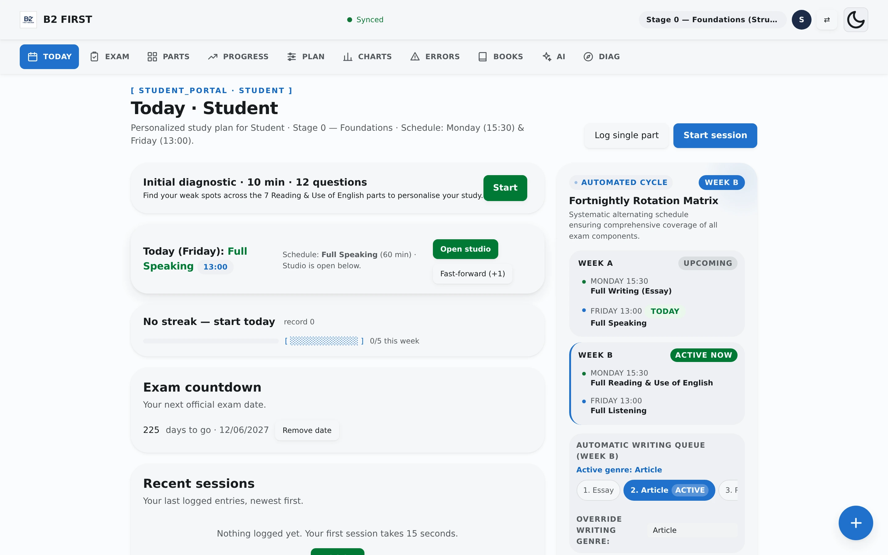
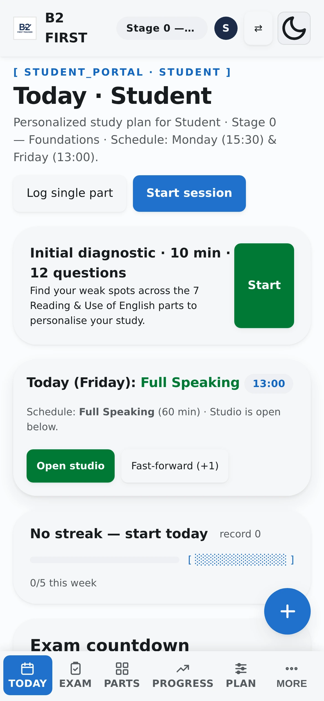

# B2 First Tracker

<p align="center">
  A study tracker that closes the feedback gap of preparing for the Cambridge B2 First alone.<br>
  It logs sessions in three taps, diagnoses which exam parts are weak, plans the week from your<br>
  intake and that diagnosis, and grades Writing against the official Cambridge band descriptors.
</p>

<p align="center">
  <a href="https://vps-server.tail40095b.ts.net"><b>Live demo</b></a> ·
  <a href="SUBMISSION.md">How it was built</a> ·
  <a href="#quick-start">Run locally</a>
</p>

<p align="center">
  
  
  
  
</p>

<table>
  <tr>
    <td width="72%"></td>
    <td width="28%"></td>
  </tr>
  <tr>
    <td align="center"><sub>Desktop: today view, exam countdown, streak and the Week A/B rotation</sub></td>
    <td align="center"><sub>Mobile: same tracker, quick-log button in one corner</sub></td>
  </tr>
</table>

## What it is

A self-hosted study tracker for the **Cambridge B2 First (FCE)** exam. One HTML file, one
Python server, no database: progress lives in the browser's `localStorage` and syncs per
account to JSON files on whatever machine serves it. It covers the whole preparation loop —
intake interview, profile-driven weekly plan, practice log, streak, exam-mode timers, per-part
analytics, error taxonomy, and an AI writing examiner that scores against the official
Cambridge assessment scales.

## Why it exists

Writing is **25% of the B2 First score**, and it is the one skill you cannot self-mark. Practice
tests come with answer keys for Reading and Listening; nothing tells you whether your essay is a
Band 3 or a Band 4, or which of the four criteria is dragging the score down. That gap is what
this project attacks.

The second problem is habit. A tracker that records five sessions in sixty-seven days is not a
tracker, it is a museum. Logging a session had to cost less than fifteen seconds on a phone, so
the quick-log sits one tap away from any screen, and the streak is derived from the log instead
of being a separate field that can drift out of sync.

## Who it is for

- **Candidates studying alone**, without a teacher or an examiner to mark their writing.
- **People preparing on a low budget**, who buy one or two official books and need to extract
  everything from them.
- **Anyone who wants their study data to stay theirs**: the app runs on a Raspberry Pi in a
  living room, writes to a plain JSON file, and only sends the text you choose to correct.

It is deliberately not a course. There is no content behind a paywall and no cloud to trust;
an account is just a name and a password — no email is asked for.

## What it does

| Feature | What it actually does |
| --- | --- |
| **Onboarding intake** | Six-step intake before the first session: exam date, target grade, self-rated skills, hours per week, available days, and what is hard. The answers seed the weekly plan, so the app is useful before you have logged anything |
| **Quick-log** | Records type, part, score and minutes in three taps, with sane defaults per part |
| **Streak** | Derived from the log, not stored: today counts, a missed day is shielded once a week, exam days never break it |
| **Diagnostic** | 12 items across the seven Reading & Use of English parts, 10 minutes, ranks the weakest parts and feeds the error taxonomy |
| **Weekly plan** | Deterministic rules, not a model: slots on your 3 weakest parts (diagnostic) or lowest-rated skills (intake), slot count from hours per week (2h→3, 10+h→6), days from your intake, one reinforcement slot per flagged struggle — each with its reason |
| **Writing examiner** | Four Cambridge criteria (Content, Communicative Achievement, Organisation, Language), 0–5 each, cited evidence, two mandatory weaknesses per criterion, three rewritten sentences |
| **Error taxonomy** | Every miss is tagged `L-GAP`, `G-ERR`, `T-MIS` or `T-LIM`, so the plan can target the cause instead of the symptom |
| **Analytics** | Four SVG panels, no chart library: progress over time, per-part accuracy, error mix, score consistency |
| **Exam mode** | Real timings for Reading & Use of English, Listening and Writing |
| **Recent activity** | Your account's security log (logins, password changes, deletion) in the Account view, straight from the server's audit log — only your own events |
| **Accounts** | Multi-user: register with a name and a password, sync across devices, and export, change password or delete your account |
| **Interface** | English UI with light and dark themes; the choice is saved per device |

## The grading is calibrated, not generous

A corrector that says 19/20 to a mediocre essay is worse than no corrector: you stop studying
what is missing. The first version did exactly that. Two changes fixed it.

1. Before scoring, the model must list **two concrete weaknesses per criterion**. If it can name
   two, that criterion cannot be a 5.
2. For any criterion scored 4 or 5 it must explain **why it is not one band higher**.

Measured on three graded samples of different quality:

| Sample | Before | After |
| --- | --- | --- |
| Weak (A2, frequent basic errors) | 19/20 | **9/20** |
| Typical B2 | 19/20 | **14/20** |
| Strong (C1-leaning, inversions, passives) | 19/20 | **20/20** |

The rubric itself is not invented: it is transcribed from the official *B2 First Handbook*
(pages 32–35), with the page number recorded next to every band descriptor in `prompts.py`.

## Stack

| Layer | Choice | Why |
| --- | --- | --- |
| Frontend | One `index.html`, vanilla JS and CSS | No build step, no `node_modules`; it opens on any phone and Playwright can drive it directly |
| Backend | `server.py`, Python standard library only | No pip install, no framework, no version drift on a small server |
| Storage | JSON files on disk, with rotated backups | Readable, diffable, trivial to back up; a database would add a dependency without adding a feature |
| AI | Provider-agnostic proxy, bring your own key | The key never leaves your device except to reach the proxy; the repository ships no credentials |

## Quick start

```bash
git clone https://github.com/Juan-Martin-Cerezo/b2first-tracker.git
cd b2first-tracker
python3 server.py
```

Open `http://127.0.0.1:8088`. That is the whole installation: no database, no migrations, no
environment file required.

Every setting is optional and lives in `B2_*` environment variables — the complete list the code
reads:

| Variable | Default | Effect |
| --- | --- | --- |
| `B2_DEMO` | `0` | `1` = demo mode: account and sync routes answer `403`, state stays in `localStorage` |
| `B2_REGISTER` | `open` | `closed` = no new accounts (existing ones still log in) |
| `B2_OWNER_PASSWORD` | `b2first` | Password given to the owner account created when migrating old single-user data |
| `B2_PUBLIC_HEALTH` | `0` | `1` = `GET /api/health` may expose absolute paths |
| `B2_AI_PROVIDER` | `deepseek` | Provider used by the writing corrector |
| `B2_AI_BASE` | (empty) | Override the provider base URL |
| `B2_AI_MODEL` | (empty) | Override the model name |
| `B2_AI_KEY` | (empty) | Server-side provider key; users can still bring their own |
| `B2_AI_DAILY_PER_USER` | `8` | AI corrections per account per day on the server key |
| `B2_AI_DAILY_TOTAL` | `80` | AI corrections per day for the whole instance on the server key |
| `B2_TEST_USER` | `test-runner` | Account the Playwright suites register (`tests/helpers.py`) |
| `B2_TEST_PASS` | `test-runner-pass-9` | Password for that account (`tests/helpers.py`) |

Optional exam material can be dropped into `~/Descargas/b2-first/`; the tracker indexes whatever
it finds and hides the section when the directory is empty.

## AI writing correction (bring your own key)

The corrector needs a provider key, and the key is yours:

1. Get one at [aistudio.google.com/apikey](https://aistudio.google.com/apikey) (Gemini) or
   [platform.deepseek.com](https://platform.deepseek.com) (DeepSeek).
2. Paste it in the **PLAN** tab; it is stored in `localStorage` on that device only.
3. On the server side the key can also come from the environment:

```bash
# outside the repository, chmod 600
B2_AI_PROVIDER=deepseek
B2_AI_MODEL=deepseek-chat
B2_AI_KEY=...
```

`POST /api/ai/writing` is a proxy: it validates the request, enforces a 25-second timeout, rate
limits to 10 requests per minute and 60 per hour per IP, validates the model's JSON against a
strict schema, and returns `422` when the shape is wrong. Keys are never logged and never written
to disk. **The repository contains no keys.**

## Accounts

Registration is open on the public instance, and every account gets its own progress file
and backup history under `data/users/<id>/` (directory `0700`, files `0600`).

| Protection | Limit |
| --- | --- |
| Registration | 5 / hour / IP |
| Login | 10 / 10 min / IP and 20 / hour / username |
| Progress write | 2 MB per save, 60 saves / min |
| AI corrections | 8 / day per account, 80 / day across the instance |
| Session token | 30 days, sliding |

Users who paste their own provider key are not charged against the instance quota — the
owner's key stays for people who just want to try it.

Every account can **export its data** as JSON, **change its password** (which invalidates the
other sessions) and **delete itself**, which removes the files from disk.

To lock an instance to a fixed set of accounts after you have created yours:

```bash
B2_REGISTER=closed python3 server.py
```

Requests that arrive through a proxy (Tailscale Funnel, Cloudflare) always carry
`X-Forwarded-For`, and the progress API requires a session token for those. Only a direct
local request may use the legacy no-token owner path.

## Demo mode

```bash
B2_DEMO=1 python3 server.py
```

In demo mode registration, login and progress sync all return `403`; the tracker runs entirely on
`localStorage`. The public instance does not use it: `GET /api/config` reports
`{"demo": false, "register": "open"}` and visitors create real accounts. Demo mode is for
installs where nobody should write data at all.

## Docker

```bash
docker build -t b2first .
docker run -p 8088:8088 -e B2_DEMO=1 b2first
```

## Tests

No mocks of the app itself: the suites drive a real browser against a real server. Every suite is
a standalone script; `tests/helpers.py` registers a throwaway account (`B2_TEST_USER`/
`B2_TEST_PASS`) so nothing depends on the owner's password.

| Suite | Covers |
| --- | --- |
| `test_final.py` | Main UI: every view renders, dark mode persists, contrast and focus rings, no JS errors |
| `test_mobile.py` | 390x844 layout: no horizontal overflow, bottom nav, quick-log button |
| `test_tracker.py` | Books and material views: cards, filters, links, audio players |
| `test_onboard.py` | Six-step intake wizard, `D.profile`, profile-driven plan, feature tour, empty states |
| `test_plan.py` | Deterministic weekly plan (`buildWeeklyPlan`) and its PLAN card |
| `test_diag.py` | Diagnostic end to end: item fetch, error taxonomy writes, result maths |
| `test_streak.py` | Streak rules: freeze shield, gaps, future dates, records, weekly goal |
| `test_schedule_advance.py` | Schedule rows and shifting sessions (`sessionOffset`) |
| `test_rot.py` | Week A/B rotation, per-skill cycles and manual overrides |
| `test_exam.py` | Exam-mode timers, pause, guides, exam-mode logging |
| `test_graf.py` | The four SVG charts and their empty states |
| `test_sync.py` | Progress persistence, backup rotation, invalid payloads |
| `test_personalization.py` | Per-account data isolation |
| `test_register.py` | Registration (open and closed), login, password change |
| `test_multiuser.py` | Accounts end to end: quotas, limits, export and delete |
| `test_ai.py` | Writing proxy against a mock provider: validation, `422` schema rejection, rate limits, no key leakage |
| `test_demo.py` | Demo mode returns `403` on every account and sync route |
| `test_hardening.py` | Id validation, concurrent writes, security headers, request ids, `/api/health`, schema migration, password reset |
| `test_legacy_guard.py` | The tokenless legacy owner path is unreachable through a proxied request |
| `test_security2.py` | Login lockout, constant-time compares, hashed tokens, payload schema, audit log |

```bash
cd tests
uv run --with playwright python test_final.py
```

Eleven suites (`test_ai`, `test_demo`, `test_diag`, `test_graf`, `test_hardening`,
`test_legacy_guard`, `test_multiuser`, `test_onboard`, `test_register`, `test_security2`,
`test_sync`) boot their own server on a temporary `data/` and never touch the real one; the other
nine run against the live service on `127.0.0.1:8088`.

## Security

- **Accounts are isolated**: each one gets its own `data/users/<id>/` (directories `0700`, files
  `0600`), and a session token for one account can never read another's data (`403`).
- **Limits and quotas**: 5 failed logins lock a username for 15 minutes, every endpoint is rate
  limited, and AI corrections are capped at 8/day per account and 80/day per instance.
- **Tokens hashed at rest**: `data/tokens.json` stores `sha256(token)`, never the token;
  passwords are PBKDF2-HMAC-SHA256 with 200,000 iterations.
- **Audit log**: authentication events land in `data/audit.log` (never tokens or passwords), and
  each account can see its own **Recent activity**.
- **Backups verified**: per-save rotation plus a daily tarball whose every run does a test
  restore and parses every JSON file before it counts.
- **Health check**: `GET /api/health` reports the data dir writable, `users.json` parsing and
  every account directory present (`200 {"ok": true}` / `503`).

Threat model, control checklist and the tested restore runbook: [SECURITY.md](SECURITY.md).
Reproducible external audit of the live instance: `bash tools/audit.sh` — 14/14 checks passed on
2026-10-30.

## Data and privacy

- Progress lives in `localStorage` and in `data/users/<id>/progress.json` on your machine, with
  the previous version kept as a rotated backup.
- `data/` is gitignored: no personal progress is ever committed.
- The only outbound call is the text you paste into the corrector, sent with your own key.
- Demo mode cannot write to `data/`; those routes answer `403`.

## Project layout

```
index.html          the entire frontend: views, timers, charts, quick-log, streak
server.py           standard-library HTTP server, auth, sync API, AI proxy
store.py            storage seam (swap JSON for SQLite without touching the API)
prompts.py          Cambridge band descriptors transcribed from the official handbook
material/           diagnostic items and local exam material index
tests/              Playwright suites
tools/              external audit script, password reset, rubric extractor
docs/               submission notes, video script, screenshots
```

## License

MIT © 2026 Juan Martín Cerezo
