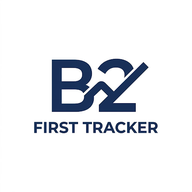
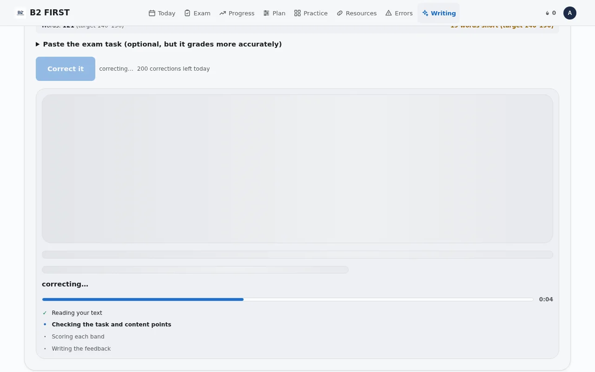

<p align="left">
  
</p>

# B2 First Tracker

Practice the Cambridge B2 First with an AI examiner, a writing corrector and a plan that knows what you did yesterday.

[](https://firsttracker.app)
[](server.py)
[](index.html)
[](tests/run_all.sh)
[](#how-the-ai-is-used)
[](LICENSE)

**Live service:** https://firsttracker.app  
**Privacy in one line:** Accounts and progress live in private per-account JSON files; speaking audio and speaking transcripts are never stored on disk, and the only analytics is cookie-free aggregate Cloudflare Web Analytics.

---

## Problem

Self-study candidates preparing for the Cambridge B2 First can check Reading, Use of English, and Listening against answer keys, but hit two walls: **Writing** and **Speaking** have no key, and studying without structure makes it hard to keep all 17 exam parts rotating before exam day. B2 First Tracker pairs a deterministic daily study plan with rubric-grounded AI feedback for Writing and a timed 4-part Speaking examiner.

---

## Screenshots

<table>
  <tr>
    <td width="50%"></td>
    <td width="50%"></td>
  </tr>
  <tr>
    <td align="center"><sub><b>Today:</b> scheduled session, timer, and collapsible Materials</sub></td>
    <td align="center"><sub><b>Speaking Exam:</b> Parts 1–4 with official timings, photos, and examiner</sub></td>
  </tr>
  <tr>
    <td width="50%"></td>
    <td width="50%"></td>
  </tr>
  <tr>
    <td align="center"><sub><b>Writing Corrector:</b> 4-band Cambridge marking with live grading steps</sub></td>
    <td align="center"><sub><b>Exam Sources:</b> 74 curated resources grouped by paper with search & filters</sub></td>
  </tr>
</table>

---

## What it does

- **Daily exam plan and 3-step session coach:** An optional 12-question diagnostic ranks your weakest exam parts. Two rotations (*By part* and *Full paper each session*) derive today's session directly from the units already logged, with a mobile-ready 3-step session coach, official Cambridge timings, streak shields, and exam-day countdown.
- **Writing corrector on all four Cambridge bands:** Marks Essays, Articles, Reports, Reviews, and Emails from 0 to 5 on *Content*, *Communicative Achievement*, *Organisation*, and *Language*. Every band quotes evidence from your text, lists concrete weaknesses, rewrites three sentences, and displays a step-by-step progress bar with elapsed time while grading.
- **Cambridge Speaking exam (Parts 1–4):** Four complete Cambridge sample papers (*B2 First Sample Paper 1 & 2*, *B2 First for Schools Sample Paper 1 & 2*) plus **Use my own task** (form + image uploads). Runs a full 14-minute mock or any single part with mandatory British examiner introduction, AI candidate partner, push-to-talk voice, official timings, Part 2 photo pairs, Part 3 task cards, and a 3-band report — with no on-screen scripts, no stored transcripts, and no pronunciation scoring.
- **Practice & Real mocks:** Timed drills for every exam part, a guided Full Mock sequence inside **Exam → Real mocks** (materials to timer in one screen, handing straight into Speaking), and a unified searchable **Library** combining local sample papers, answer keys, audio, tapescripts, checklists, and 74 verified online sources — plus private user-uploaded Listening practice files.
- **Progress, Error Taxonomy, and Progression Matrix:** Three zero-dependency SVG charts track score evolution over time, weakest Reading & Use of English parts, and weekly consistency, alongside a stage Progression Matrix and a dedicated root-cause Error Taxonomy view (*L-GAP*, *G-ERR*, *T-MIS*, *T-LIM*).

---

## How the AI is used

| Provider | Task | Model | Approx. cost | Fallback |
| --- | --- | --- | --- | --- |
| **Google (Gemini API)** *(Speaking voice)* | Push-to-talk Speaking v3 STT + formal British examiner & partner TTS (`POST /api/speaking/v3/sessions/...`) | `gemini-2.5-flash` + `gemini-2.5-flash-preview-tts` | ~$0.047 per 14-min mock | Returns `503 speech_not_configured` (never simulates voices) |
| **DeepSeek** *(default; or Gemini)* | Writing 4-band grading and Speaking partner reactions | `deepseek-chat` (strict JSON capped at 8 KB) | ~$0.0011–$0.0022 / writing; ~$0.0003 / partner line | Bring-your-own key (BYO); scripted partner lines from test bank |

- **Server-side keys only:** Shared API keys live in the server environment (`chmod 600` env file) and never reach the browser or the repository.
- **Bring your own key (BYO):** Users can configure their own provider key in **Settings → AI provider**. It stays in browser `localStorage`, is forwarded only on that user's requests, is never stored on the server, and bypasses shared service quotas.
- **No speaking audio or transcripts stored:** Push-to-talk clips are transcribed in memory for the single turn and discarded immediately. Session state stores only counters, flags, and numeric micro-scores (24-hour expiry); no audio or candidate text is ever written to disk or returned to the browser. Images uploaded under **Use my own task** are stored privately in your account until you delete the task or your account.

---

## The Speaking exam

The Speaking exam runs as a full-screen exam room modelled on the real Cambridge table — one part at a time or the full 14 minutes of Parts 1–4 — with **four sample exams** (*B2 First Sample Paper 1 & 2*, *B2 First for Schools Sample Paper 1 & 2*) plus **Use my own task**:

| Phase / Part | Time | What happens |
| --- | --- | --- |
| **Introduction** | Mandatory (untimed) | Formal British examiner (Mr Thompson) greets you, asks your name and where you live, and introduces your AI partner before starting the requested part. |
| **Part 1** | 2 min | Personal interview questions alternating between you and your partner. |
| **Part 2** | 4 min | Two photographs appear side-by-side on the table; you compare them for 1 minute, your partner answers a 30-second follow-up, then roles swap for Task 2. |
| **Part 3** | 4 min | Task card appears for 15 seconds of preparation, followed by a 2-minute discussion with your partner and a 1-minute decision phase. |
| **Part 4** | 4 min | Discussion questions extending the Part 3 topic, alternating with your partner. |

**Audio-only exam room.** Like a real Cambridge exam, you see only what sits on the table: Part 2 photographs, the Part 3 task card, the official countdown timer, the active speaker indicator (Examiner · Partner · You), and the **Hold to speak** push-to-talk button. No question scripts, chat bubbles, or transcripts are ever shown on screen.

**Own tasks.** Under **Use my own task**, you can create single-part or full tasks through a standard form (title, part, questions/prompts, and optional uploaded photographs or Part 3 card image). Uploaded images stay private to your account until you delete the task or your account. Official sample-paper imagery credits are documented in [`assets/speaking/exams/CREDITS.md`](assets/speaking/exams/CREDITS.md) and [`assets/speaking/CREDITS.json`](assets/speaking/CREDITS.json).

**The 3-band report.** At the end of a session, the report presents estimated Cambridge B2 First bands (0–5) across **Grammar & Vocabulary**, **Discourse Management**, and **Interactive Communication**, plus targeted comments. Pronunciation is not scored or shown. Nothing is added to your progress until you press **Save report**, which saves only the compact band summary and session flags — never audio or transcripts.

---

## What it does not do

This is a practice tool, not an exam board. The Writing and Speaking bands are estimates against the published Cambridge scales: useful for finding the next thing to fix, but not an official result, not a certificate and not a claim about the grade you will be given. The app is not affiliated with or endorsed by Cambridge.

- **No pronunciation scoring.** Speaking reports assess *Grammar & Vocabulary*, *Discourse Management*, and *Interactive Communication* only; pronunciation is not measured or guessed.
- **No simulated voice fallback.** Speaking requires server speech configuration (`B2_SPK_GOOGLE_KEY`). When unconfigured, the server returns `503 speech_not_configured` clearly instead of faking voices.
- **You need an account.** Every session belongs to an account (username + 12-character password, Google sign-in, or passkey). There is no anonymous mode and no local-only mode.

---

## Architecture

Zero third-party Python dependencies (`http.server.ThreadingHTTPServer`), zero frontend build step, zero external database.

```text
browser (index.html · push-to-talk MediaRecorder + Web Audio playback)
  │
  └── HTTPS ──► server.py (Python 3.11+ stdlib)
                  ├── static HTML/assets (landing.html, index.html, material/, assets/speaking/exams/)
                  ├── auth & security (PBKDF2-600k, OAuth, WebAuthn, TOTP MFA, CSP)
                  ├── store.py ──► per-account atomic JSON + 20-version backups
                  ├── plans.py ──► per-account UTC daily usage meter
                  ├── speaking_v3/ ──► state machine, British tone rules, 4 sample exams, own-task images
                  └── AI proxies ──► DeepSeek / Gemini (writing, speaking STT/TTS, partner lines)
```

### Main files

| File | Role |
| --- | --- |
| [`server.py`](server.py) | Standard-library `ThreadingHTTPServer`: routing, auth, CSP/security headers, rate limits, AI & Speaking v3 APIs. |
| [`speaking_v3/`](speaking_v3/) | Speaking v3 engine (`engine.py`), British examiner tone rules (`tone.py`), catalog & multipart own tasks (`catalog.py`, `multipart.py`), semantic validation (`validation.py`), and Gemini STT/TTS voice client (`voice.py`). |
| [`store.py`](store.py) | Storage seam for atomic JSON reads/writes, per-account progress, backups, and speaking ledgers. |
| [`plans.py`](plans.py) | Service-level daily caps (`service`, `byo`, `owner`) and UTC day/week/month usage meter (`data/usage.json`). |
| [`prompts.py`](prompts.py) | Official Cambridge B2 First Writing rubric and strict-JSON grading prompts. |
| [`oauth_google.py`](oauth_google.py) | Stdlib Google OAuth 2.0 + PKCE and RS256 JWKS `id_token` verification. |
| [`webauthn.py`](webauthn.py) | Stdlib CBOR/COSE WebAuthn passkey registration and assertion verification. |
| [`mfa.py`](mfa.py) | RFC 6238 TOTP two-factor authentication and hashed one-time recovery codes. |
| [`legal.py`](legal.py) | Sanitized stdlib Markdown renderer serving `/privacy`, `/terms`, and `/security` from `docs/`. |
| [`wordlist.py`](wordlist.py) | Embedded 1,000-entry sourced password blocklist plus deterministic derivatives (22,492 candidates). |
| [`index.html`](index.html) | Complete single-file tracker UI (EN/ES i18n, light/dark oklch themes, SVG charts, exam timers, Speaking v3 room). |
| [`landing.html`](landing.html) | Public landing page served at `/`. |
| [`material/`](material/speaking/tests/) | Static exam banks (`speaking/tests/01..04.json`, `diagnostico.json`, `writing-samples.json`). |

---

## Quick start

### Try the hosted app

1. Open https://firsttracker.app and click **Start free** (or **Create an account**).
2. Choose a username and a password of at least 12 characters (no email required), or sign in with Google.
3. Set your exam date in onboarding (you can click **Skip for now** on the 12-question diagnostic and run it later).
4. Submit a 140–190 word essay in **Writing**, or open **Speaking Exam** from **Today**.

### Run locally from source

Requires Python 3.11+ (stdlib only — no `pip install`, no Node.js):

```bash
git clone https://github.com/Juan-Martin-Cerezo/b2first-tracker.git
cd b2first-tracker
python3 server.py
```

The server listens on `http://127.0.0.1:8088` (`/` is the landing page, `/app` is the tracker) and stores accounts and progress under `./data/`.

- **Creating your local account:** Open `http://127.0.0.1:8088/app`, click **Create an account**, and pick a username and 12+ character password. There is no anonymous or demo mode in `server.py`.
- **Enabling AI locally:** Export a text provider key and/or Google Gemini key before starting `server.py` (see [`docs/CONFIGURATION.md`](docs/CONFIGURATION.md)), or paste your own key directly inside **Settings → AI provider** in the browser.
- **Docker:** `docker build -t b2first . && docker run -p 8088:8088 -v b2data:/app/data b2first`

---

## Configuration

All runtime settings are passed as environment variables (never committed to the repo). See [`docs/CONFIGURATION.md`](docs/CONFIGURATION.md) for the exact environment variable names and complete reference.

| Setting | Default | Effect |
| --- | --- | --- |
| Text AI provider | `deepseek` | Selects `deepseek` or `gemini` for Writing grading, Speaking partner lines, and Speaking reports. |
| Text AI model | `deepseek-chat` (`gemini-2.0-flash` for Gemini) | Model ID forwarded to the text provider. |
| Text AI API key | *(unset)* | Shared server-side key for text grading. When unset, server grading returns `503 ai_not_configured` unless a BYO key is supplied. |
| Speaking Google key | *(unset)* | Enables Speaking v3 push-to-talk transcription (`gemini-2.5-flash`) and British examiner/partner TTS (`gemini-2.5-flash-preview-tts`). |
| Instance daily AI / voice caps | `1200` text calls / `600` voice min | Instance-wide ceilings across non-owner accounts (hosted production sets tighter caps to match prepaid balance). |
| Global monthly voice guard | `900` min / month | Hard monthly ceiling tracked in `data/spk_spend.json`; enforced on **every** account including owners. |
| Owner account IDs | `owner` | Comma-separated user IDs exempt from daily writing/speaking caps (monthly guard and per-minute rate limits still apply). |
| Bind address & port | `127.0.0.1` · `8088` | Loopback by default for reverse-proxy deployments; override via `PORT` and bind host setting. |
| Data directory | `./data` | Location for accounts, hashed tokens, progress, backups, usage meter, and audit log (`DATA_DIR`). |
| Registration policy | `open` | Set to `closed` to disable new public signups. |

---

## Limits & cost

### Daily & monthly limits

| Tier | Writing evaluations | Speaking mocks / minutes | Global monthly Live guard |
| --- | --- | --- | --- |
| **Standard account (`service`)** | **5 / UTC day** (`plans.py`) | **3 mocks · 45 min / UTC day** (`plans.py`) | Enforced (`900` min/month default) |
| **Bring-your-own key (`byo`)** | Unmetered by server | Unmetered by server | Billed to user's own key |
| **Owner account (`owner`)** | Uncapped per day (`plans.py`) | Uncapped per day (`plans.py`) | **Enforced** (applies to everyone) |
| **Hosted instance ceiling** | Configurable (20 text calls/day on hosted instance) | Configurable (25 voice min/day on hosted instance) | Enforced across all accounts |

### Estimated provider cost per session

Measured against published DeepSeek and Google Gemini API pricing (documented in `plans.py`):

| Action | Provider / model | Estimated cost |
| --- | --- | --- |
| Writing evaluation (140–190 words + rubric prompt) | DeepSeek (`deepseek-chat`) | ~$0.0011 (off-peak) – $0.0022 (peak) |
| Speaking partner reaction (1 line) | DeepSeek (`deepseek-chat`) | ~$0.0003 |
| Full 14-minute Speaking v3 mock (push-to-talk STT + TTS) | Google (`gemini-2.5-flash` + TTS) | ~$0.047 |

---

## Testing

The repository ships **160 standalone test suites** under `tests/test_*.py` (no pytest required). Every suite boots an isolated server with a throwaway `DATA_DIR`, a free port, and offline provider stubs, so real user data is never touched and no network calls are made.

```bash
cd tests
uv run --no-project --with playwright --with httpx python test_final.py
uv run --no-project --with playwright --with httpx python test_readme_limits.py
uv run --no-project --with playwright --with httpx python test_landing_honest.py

# Run every suite with one exit code (logs saved to tests/out/run_all/)
./run_all.sh
./run_all.sh speaking    # run only suites matching a substring
```

| Group | Representative suites | What they verify |
| --- | --- | --- |
| **UI, layout & i18n** | `test_final.py`, `test_layout.py`, `test_mobile.py`, `test_i18n.py`, `test_landing_honest.py` | Every view renders with zero JS/CSP errors, light/dark contrast >= 4.5:1, EN/ES parity, 360/390/768/1440 px layout. |
| **Plan, diagnostic & progress** | `test_plan.py`, `test_diag.py`, `test_streak.py`, `test_progression.py`, `test_graf.py`, `test_progress_view.py`, `test_today_compact.py` | Deterministic rotation, 12-item diagnostic, streak shields, stage gates, three SVG charts. |
| **Writing AI & guards** | `test_ai.py`, `test_ai_guard.py`, `test_writing_progress.py` | Strict JSON schema validation, injection/leak guards, live progress bar and elapsed timer, rate limits. |
| **Speaking v3 exam & UI** | `test_speaking_v3_catalog.py`, `test_speaking_v3_intro.py`, `test_speaking_v3_parts.py`, `test_speaking_v3_validation.py`, `test_speaking_v3_tone.py`, `test_speaking_v3_own_task.py`, `test_speaking_v3_privacy.py`, `test_speaking_v3_ui.py`, `test_speaking_v3_no_old_ui.py` | 4 Cambridge sample exams, mandatory British intro, push-to-talk audio order, Part 2 photos, Part 3 15s prep & card, multipart own tasks, 3-band report, zero transcripts/audio stored. |
| **Materials & sources** | `test_practice_real.py`, `test_where_to_find.py`, `test_exam_sources_blocks.py`, `test_listening_own_material.py` | Real exam resources, paired keys, 74 searchable Exam sources, private Listening uploads. |
| **Auth & accounts** | `test_register.py`, `test_multiuser.py`, `test_auth_methods.py`, `test_mfa.py`, `test_owner_unlimited.py` | Account isolation, Google OAuth, WebAuthn passkeys, TOTP MFA, owner limits, export & deletion. |
| **Security, legal & load** | `test_security2.py`, `test_security3.py`, `test_server_hardening.py`, `test_legal.py`, `test_readme_limits.py`, `test_capacity.py` | Lockout/backoff, hash-chained audit log, CSP, raw HTTP limits, `/privacy` `/terms` `/security`, measured p95 throughput. |

---

## Privacy & security

Progress lives in private per-account JSON files on the server (PBKDF2-HMAC-SHA256 @ 600,000 iterations, SHA-256 hashed tokens, hash-chained audit log, zero speaking audio or speaking transcripts written to disk, and only cookie-free aggregate Cloudflare Web Analytics — no ads or profiling).

- [Privacy Policy](docs/PRIVACY.md) (`/privacy`)
- [Terms of Use](docs/TERMS.md) (`/terms`)
- [Security Policy](docs/SECURITY.md) (`/security`) & [Security Model](SECURITY.md)
- [Data Map](docs/DATA-MAP.md) & [ASVS 4.0.3 Checklist](docs/SECURITY-CHECKLIST.md)
- [Hackathon Submission Notes](docs/HACKATHON.md)
- [Documentation Index](docs/README.md)

---

## Credits & attribution

- **Runtime & web platform:** Python 3.11+ standard library (`http.server`, `hashlib`, `hmac`, `secrets`, `urllib.request`, `json`), vanilla HTML/CSS/JavaScript, `MediaRecorder`, and Web Audio API. Zero third-party Python or JS runtime dependencies.
- **AI APIs & pretrained models:** [DeepSeek API](https://platform.deepseek.com/) (`deepseek-chat`) for Writing grading and Speaking partner replies; [Google Gemini API](https://ai.google.dev/) (`gemini-2.5-flash` and `gemini-2.5-flash-preview-tts`) for push-to-talk Speaking STT and examiner/partner TTS.
- **Photography & exam visual credits:** Sample paper visuals are credited for personal educational practice in [`assets/speaking/exams/CREDITS.md`](assets/speaking/exams/CREDITS.md), and Wikimedia Commons photography credits remain in [`assets/speaking/CREDITS.json`](assets/speaking/CREDITS.json).
- **Testing & tooling (dev-only):** [Playwright](https://playwright.dev/python/) (Apache-2.0) and [HTTPX](https://www.python-httpx.org/) (BSD-3-Clause), invoked via `uv` for automated verification only.
- **Exam framework disclaimer:** Cambridge and B2 First are trademarks of Cambridge University Press & Assessment. Assessment criteria follow the publicly published B2 First handbook scales; this project is an independent study tool and is not affiliated with or endorsed by Cambridge.
- **AI coding assistants:** Parts of the codebase, refactoring, automated test suites, and documentation were drafted and reviewed with AI coding assistants (Claude and Gemini) under the author's direction and verification.

---

## Roadmap

- **Rubric calibration against real marked scripts:** Benchmark Writing and Speaking band estimates against published Cambridge examiner commentaries (`tools/calibrate.py`).
- **Full ASVS top-3,000 password blocklist:** Expand `wordlist.py` from the current 1,000 sourced entries (plus derivatives) to the full top-3,000 list.
- **Teacher / classroom view:** Optional read-only progress summary for academies or tutors reviewing a student's writing and error log.
- **Offline practice packs:** Service-worker caching for static practice papers and answer keys when studying without a connection.

---

## License

[MIT](LICENSE) © 2026 Juan Martín Cerezo
